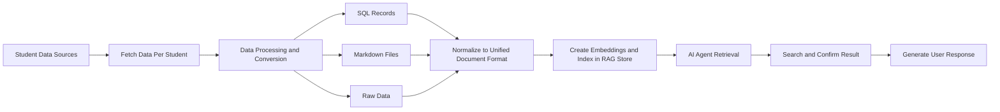

# Current System Workflow Flowchart

This diagram reflects the currently implemented runtime flow in the app.

## End-to-End App Workflow

```mermaid
flowchart TD
    A[App Launch] --> B[main.dart]
    B --> C[Load .env via flutter_dotenv]
    C --> D[Create ChatProvider in MultiProvider]
    D --> E[ChatProvider._initialize]
    E --> F[Add initial welcome: initializing knowledge base]
    F --> G[ContextService.initialize]

    G --> H[Prepare structured docs from MockData]
    H --> I[RAGService.initializeFromStructured]
    I --> J[EmbeddingService.initialize corpus]
    J --> K[Chunk docs + create embeddings]
    K --> L[VectorStore.addDocuments]
    L --> M[ChatProvider isInitialized=true]
    M --> N[Replace welcome with ready message]

    N --> O[SplashScreen]
    O --> P[AuthScreen]
    P --> Q[DashboardScreen]
    Q --> R[ChatScreen tab]

    R --> S[User enters message]
    S --> T[ChatProvider.sendMessage]
    T --> U{isInitialized?}
    U -- No --> V[Bot: Please wait, still initializing]
    U -- Yes --> W[Add user message + set loading]

    W --> X[ContextService.retrieveRelevantContext]
    X --> Y{RAG initialized?}
    Y -- No --> G
    Y -- Yes --> Z[RAGService.retrieveContext]

    Z --> ZA[VectorStore.hybridSearch]
    ZA --> ZB[Vector score cosine similarity]
    ZA --> ZC[Keyword score BM25]
    ZB --> ZD[Combine weighted score 0.7/0.3]
    ZC --> ZD
    ZD --> ZE[Top K results default 3]
    ZE --> ZF{Context empty?}
    ZF -- Yes --> ZG[Fallback to formatted student info]
    ZF -- No --> ZH[Build context blocks with relevance]

    ZG --> I1[GroqService.chat]
    ZH --> I1
    I1 --> I2[POST to Groq chat completions API]
    I2 --> I3[System prompt + user message + context]
    I3 --> I4{HTTP 200?}
    I4 -- Yes --> I5[Parse response text]
    I4 -- No --> I6[Throw API exception]

    I5 --> I7[Add assistant message]
    I6 --> I8[Add error message]
    I7 --> I9[set loading=false]
    I8 --> I9
    I9 --> I10[ChatScreen rebuilds list]
    I10 --> I11[Auto-scroll to latest message]
```

## Key Runtime Components

- Entry and DI setup: main.dart
- State and orchestration: lib/providers/chat_provider.dart
- Context retrieval facade: lib/services/context_service.dart
- RAG pipeline: lib/services/rag/rag_service.dart
- Retrieval store and ranking: lib/services/rag/vector_store.dart
- Embeddings and similarity: lib/services/rag/embedding_service.dart
- LLM call layer: lib/services/groq_service.dart
- UI navigation and interaction: lib/ui/screens/splash_screen.dart, lib/ui/screens/auth_screen.dart, lib/ui/screens/dashboard_screen.dart, lib/ui/screens/chat_screen.dart

## Notes About Current Behavior

- Authentication screen is currently UI-only and always enters app on action.
- Knowledge base is initialized from local mock data, not remote DB.
- Retrieval uses in-memory vectors with TF-IDF style embeddings.
- Generation is cloud-based through Groq API.

## Future Planned Workflow

This is the planned pipeline for the next implementation phase.

### Planned Stage Breakdown

1. Fetch student-specific data from connected systems.
2. Convert heterogeneous input formats (SQL, Markdown, raw) into a unified schema.
3. Build embeddings and store them in the RAG index.
4. Use the AI agent to retrieve relevant context for a query.
5. Run a search-and-confirm step to validate selected evidence.
6. Return a grounded response to the user.